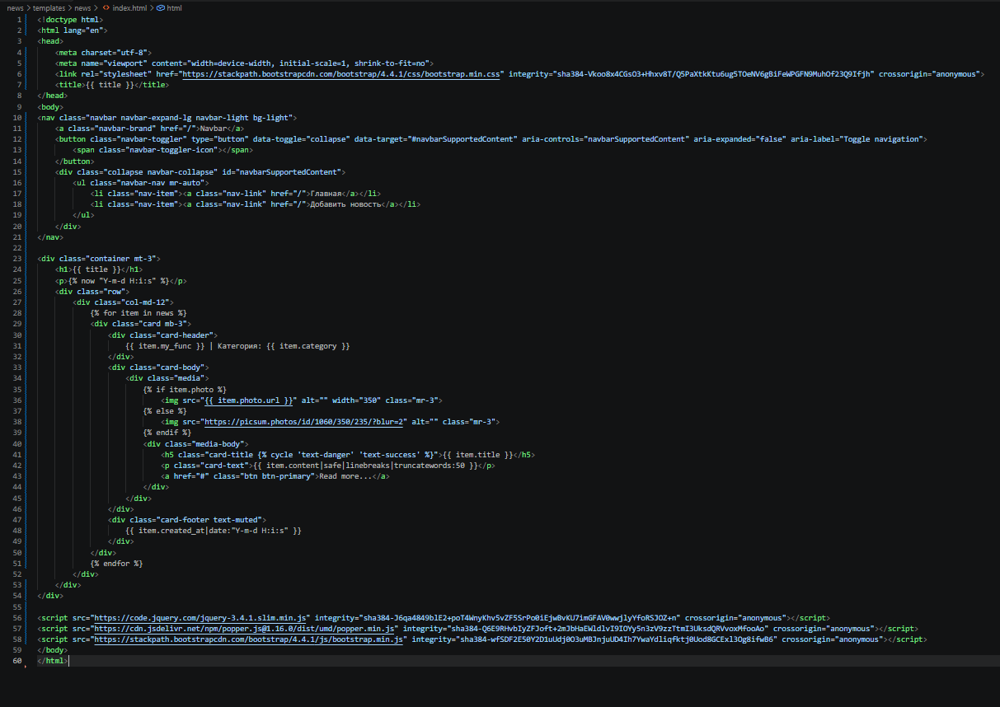
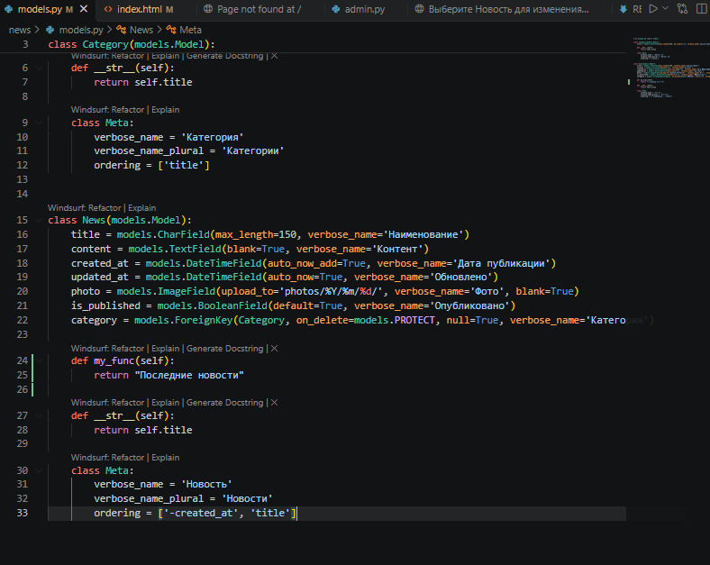
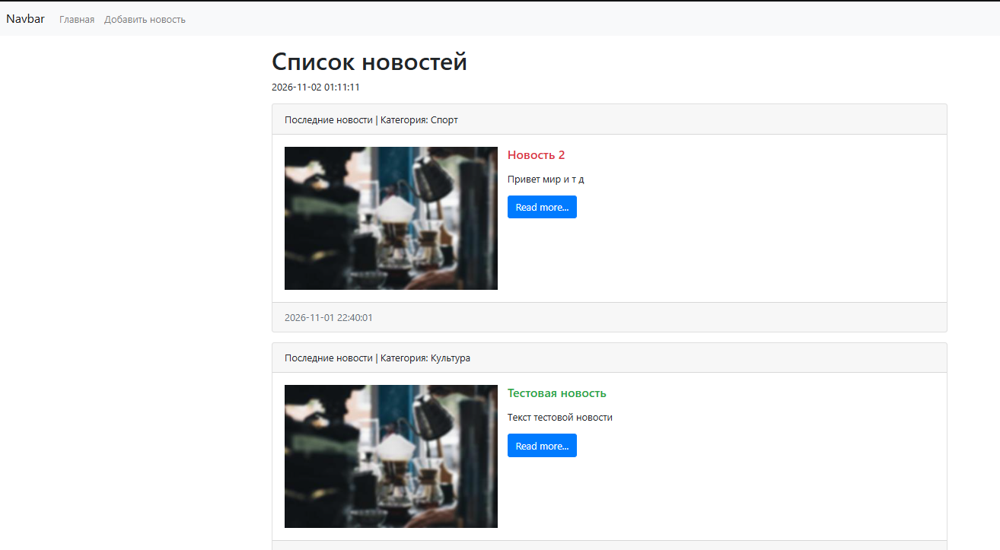
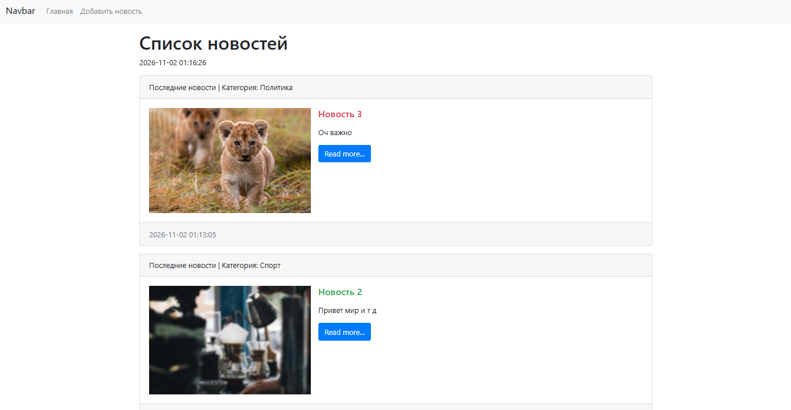

# Лабораторная работа № 5: Внешний вид шаблона. Директивы. Теги. Фильтры

**Тема:** оформление страницы новостей с помощью Bootstrap и применение возможностей шаблонов Django.  
**Проект:** новостной сайт на Django.

## Содержание

- [Цель работы](#цель-работы)
- [Описание проекта](#описание-проекта)
- [Структура проекта](#структура-проекта)
- [Реализация лабораторной работы](#реализация-лабораторной-работы)
- [Использованные теги и фильтры Django](#использованные-теги-и-фильтры-django)
- [Скриншоты результатов](#скриншоты-результатов)
- [Установка и запуск](#установка-и-запуск)
- [Контрольные вопросы](#контрольные-вопросы)
- [Вывод](#вывод)

## Цель работы

Изучить оформление HTML-шаблонов Django с использованием Bootstrap, научиться выводить в шаблоне данные моделей и применять встроенные теги и фильтры Django Template Language (DTL). В работе рассматриваются циклы, условные конструкции, вызов методов модели, форматирование даты, обработка текста и отображение изображений.

## Описание проекта

Проект представляет собой новостную ленту. Данные хранятся в базе SQLite и представлены моделями `News` и `Category` приложения `news`.

На странице `/news/` отображается список новостей. Каждая карточка содержит категорию, заголовок, текст, изображение и дату публикации. Для оформления используется Bootstrap 4.4.1, подключённый через CDN.

### Модель `News`

В `news/models.py` у модели `News` используются следующие поля:

| Поле | Тип | Назначение |
|---|---|---|
| `title` | `CharField` | Заголовок новости |
| `content` | `TextField` | Текст новости; поле может быть пустым |
| `created_at` | `DateTimeField` | Дата и время создания записи |
| `updated_at` | `DateTimeField` | Дата и время последнего обновления |
| `photo` | `ImageField` | Изображение новости; поле может быть пустым |
| `is_published` | `BooleanField` | Признак публикации, по умолчанию `True` |
| `category` | `ForeignKey` | Связь с категорией новости |

У модели также определён метод `my_func()`, возвращающий строку «Последние новости». Метод `__str__()` возвращает заголовок новости.

### Модель `Category`

Модель `Category` содержит поле `title` с названием категории. Метод `__str__()` возвращает это название. Для модели задана сортировка по полю `title`.

## Структура проекта

```text
lab_5-web_app-main/
├── manage.py
├── db.sqlite3
├── html_code.png
├── main_page.png
├── my_func.png
├── news_update.png
├── media/
│   └── photos/
├── MySite/
│   ├── settings.py
│   ├── urls.py
│   ├── asgi.py
│   └── wsgi.py
└── news/
    ├── migrations/
    ├── templates/
    │   └── news/
    │       └── index.html
    ├── admin.py
    ├── apps.py
    ├── models.py
    ├── views.py
    └── tests.py
```

Назначение основных файлов:

- `manage.py` — запуск команд управления Django.
- `MySite/settings.py` — настройки проекта, подключение приложения `news`, параметры SQLite и медиафайлов.
- `MySite/urls.py` — маршруты административной панели и страницы `/news/`, а также раздача медиафайлов в режиме отладки.
- `news/models.py` — модели `News` и `Category`.
- `news/views.py` — получение новостей из базы данных и передача их шаблону.
- `news/admin.py` — регистрация моделей и настройка административной панели.
- `news/templates/news/index.html` — HTML-шаблон новостной ленты.
- `news/migrations/` — миграции базы данных.
- `db.sqlite3` — база данных SQLite.
- `media/` — загруженные изображения новостей.

## Реализация лабораторной работы

### 1. Подключение Bootstrap

В шаблоне `news/templates/news/index.html` подключены CSS- и JavaScript-файлы Bootstrap 4.4.1 через CDN. Это позволяет использовать готовые компоненты и классы оформления без локальной установки Bootstrap.

Для навигации используется компонент Navbar. Основное содержимое размещено в контейнере Bootstrap (`container`), а отдельные новости выводятся в карточках (`card`). Для отступов применяются классы `mt-3` и `mb-3`, для оформления заголовков и кнопок — `card-title`, `btn` и `btn-primary`.

### 2. Передача данных из представления в шаблон

В файле `news/views.py` функция `index` получает записи модели `News` и передаёт их в шаблон вместе с заголовком страницы:

```python
from django.shortcuts import render
from .models import News


def index(request):
    news = News.objects.all()
    context = {
        'news': news,
        'title': 'Список новостей',
    }
    return render(request, 'news/index.html', context)
```

Переменные контекста используются в шаблоне через двойные фигурные скобки: `{{ title }}` выводит заголовок страницы, а `{{ item.title }}` — заголовок конкретной новости.

### 3. Вывод списка новостей и данных категории

Для перебора записей применяется тег ``. Внутри цикла для каждой записи создаётся отдельная Bootstrap-карточка.

В шапке карточки выводятся результат вызова метода модели `{{ item.my_func }}` и связанная категория `{{ item.category }}`. Заголовок новости выводится через `{{ item.title }}`, текст — через `{{ item.content }}` с применением фильтров.

### 4. Отображение изображения

Для проверки наличия изображения используется условный тег ``. Если фотография загружена, шаблон выводит её по адресу `{{ item.photo.url }}`. Если изображения нет, показывается резервная картинка с сайта `picsum.photos`.

В модели `News` для фотографий используется поле `ImageField` с каталогом загрузки `photos/%Y/%m/%d/`. В настройках проекта заданы `MEDIA_URL` и `MEDIA_ROOT`, а в `MySite/urls.py` добавлена раздача медиафайлов при `DEBUG=True`.

### 5. Чередование оформления заголовков

В классе заголовка карточки используется тег ``. Он по очереди подставляет CSS-классы `text-danger` и `text-success`, поэтому заголовки новостей чередуются по цвету.

### 6. Отображение даты и текущего времени

Тег `` выводит текущую дату и время. Дата создания каждой новости форматируется фильтром `date`:

```django
{{ item.created_at|date:"Y-m-d H:i:s" }}
```

Таким образом, дата публикации отображается в едином формате год-месяц-день и часы:минуты:секунды.

## Использованные теги и фильтры Django

| Конструкция | Назначение в проекте |
|---|---|
| `{{ ... }}` | Вывод значения переменной или атрибута объекта |
| `` | Перебор списка новостей |
| `` / `` | Проверка наличия фотографии и выбор изображения |
| `` | Чередование CSS-классов заголовков |
| `` | Вывод текущей даты и времени |
| `safe` | Отключает автоматическое HTML-экранирование содержимого |
| `linebreaks` | Преобразует переносы строк в HTML-абзацы и переносы |
| `truncatewords:50` | Ограничивает отображаемый текст 50 словами |
| `date` | Форматирует дату и время публикации |

В шаблоне текст новости обрабатывается цепочкой `safe`, `linebreaks` и `truncatewords:50`:

```django
{{ item.content|safe|linebreaks|truncatewords:50 }}
```

Фильтр `safe` следует применять только к доверенному содержимому: он разрешает вывод HTML-разметки, содержащейся в тексте.

## Скриншоты результатов

Все приведённые изображения находятся в корневой папке проекта.

### 1. HTML-шаблон новостной страницы



*Подключение Bootstrap, навигационная панель, цикл новостей, условия для изображения и фильтры шаблона.*

### 2. Метод модели `my_func`



*Определение метода `my_func()` в модели `News`.*

### 3. Результат отображения новостной ленты



*Карточки новостей с категориями, изображениями, заголовками, текстом и датами публикации.*

### 4. Обновлённая новостная лента



*Пример отображения новостей с разными категориями и загруженными изображениями.*

## Установка и запуск

Для запуска необходимы Python, Django и Pillow. Pillow используется для работы с полем `ImageField`. В архиве проекта файл `requirements.txt` отсутствует, поэтому зависимости устанавливаются командами ниже.

1. Распаковать архив и открыть терминал в папке проекта, где находится `manage.py`.

2. Создать виртуальное окружение:

   ```bash
   python -m venv venv
   ```

3. Активировать виртуальное окружение.

   **Windows:**
   ```bash
   venv\Scripts\activate
   ```

   **Linux / macOS:**
   ```bash
   source venv/bin/activate
   ```

4. Установить зависимости:

   ```bash
   pip install django pillow
   ```

5. Применить миграции:

   ```bash
   python manage.py migrate
   ```

6. При необходимости создать пользователя административной панели:

   ```bash
   python manage.py createsuperuser
   ```

7. Запустить сервер разработки:

   ```bash
   python manage.py runserver
   ```

После запуска доступны следующие адреса:

- Новостная лента: <http://127.0.0.1:8000/news/>
- Панель администратора: <http://127.0.0.1:8000/admin/>

Для просмотра и редактирования новостей и категорий необходимо войти в административную панель под учётной записью администратора.

## Контрольные вопросы

### 1. Для чего предназначен Bootstrap?

**Ответ:** Bootstrap — это CSS- и JavaScript-фреймворк с готовыми компонентами и классами оформления. Он помогает быстрее создавать адаптивные интерфейсы. В проекте Bootstrap используется для навигационной панели, контейнера и карточек новостей.

### 2. Что такое CDN и зачем он используется в проекте?

**Ответ:** CDN (Content Delivery Network) — сеть серверов, с которых можно получать статические ресурсы. В проекте CSS- и JavaScript-файлы Bootstrap подключаются по CDN-ссылкам, поэтому их не требуется хранить в проекте локально.

### 3. Как передать данные из представления Django в HTML-шаблон?

**Ответ:** Данные передаются в шаблон через контекст функции `render()`. В данном проекте представление `index` передаёт словарь `context` с переменными `news` и `title`. В шаблоне значения выводятся конструкциями `{{ news }}` и `{{ title }}` или через атрибуты объектов.

### 4. Для чего используется тег `for`?

**Ответ:** Тег `` перебирает элементы последовательности. В проекте он проходит по объектам `news`, чтобы сформировать отдельную карточку для каждой новости.

### 5. Для чего используются теги `if` и `else`?

**Ответ:** Они позволяют выполнять условный вывод. В шаблоне проверяется наличие фотографии `item.photo`: при наличии выводится загруженное изображение, в противном случае — резервная картинка.

### 6. Как работает тег `cycle`?

**Ответ:** Тег `` по очереди возвращает переданные значения и повторяет последовательность после последнего значения. В проекте он чередует CSS-классы `text-danger` и `text-success` для заголовков новостей.

### 7. Для чего нужен тег `now`?

**Ответ:** Тег `` выводит текущую дату и/или время в указанном формате. В проекте используется формат `Y-m-d H:i:s`.

### 8. Что делают фильтры `date`, `linebreaks` и `truncatewords`?

**Ответ:** `date` форматирует дату или время; `linebreaks` преобразует переносы строк в HTML-разметку; `truncatewords` ограничивает текст заданным количеством слов. В шаблоне содержимое новости ограничивается 50 словами.

### 9. Как вызвать метод модели из шаблона Django?

**Ответ:** К методу объекта можно обратиться через точечную запись, например `{{ item.my_func }}`. В шаблоне Django вызов метода без аргументов выполняется без круглых скобок. В проекте метод `my_func()` возвращает текст «Последние новости».

### 10. Как в шаблоне вывести загруженное изображение?

**Ответ:** Сначала проверяется наличие файла, например ``. Затем адрес изображения получается через `{{ item.photo.url }}`. Для работы с изображениями в проекте используется поле `ImageField`, а параметры хранения медиафайлов задаются через `MEDIA_URL` и `MEDIA_ROOT`.

## Вывод

В ходе лабораторной работы был оформлен шаблон новостной ленты с использованием Bootstrap 4.4.1, подключённого через CDN. В шаблоне реализован вывод списка новостей и связанных категорий, отображение изображений с резервной картинкой, форматирование текста и дат. На практике использованы теги Django `for`, `if`, `else`, `cycle`, `now`, обращение к методу модели, а также фильтры `safe`, `linebreaks`, `truncatewords` и `date`.

В результате получена страница новостей с карточным отображением записей и чередованием цветов заголовков.

> Примечание: ссылки «Главная», «Добавить новость» и кнопки «Read more...» в текущем шаблоне ведут на `/` или `#`. Отдельные маршруты добавления и просмотра новости в представленном проекте не реализованы.
